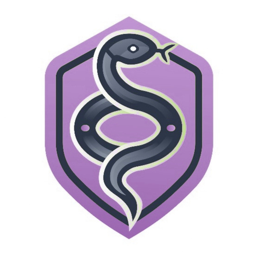
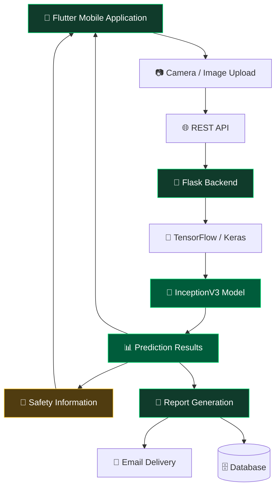

<div align="center">



# 🐍 VENOM VERSE

### Intelligent Wildlife Identification & Emergency Assistance

**Identify. Understand. Respond.**

An AI-powered mobile application designed to identify potentially venomous snakes, spiders, and insects through image recognition and provide educational emergency guidance.

<br>


<br>


<br>

**[Overview](#-overview) • [Features](#-key-features) • [Architecture](#-system-architecture) • [Installation](#-installation) • [API](#-api-reference) • [AI Models](#-machine-learning) • [Roadmap](#-future-roadmap)**

---

### 🧬 Where Artificial Intelligence Meets Wildlife Safety

*Turning visual recognition into actionable information.*

</div>

<br>

## 🌿 Overview

**Venom Verse** is an intelligent wildlife identification application that combines computer vision, deep learning, and mobile technology to help users recognize potentially dangerous wildlife.

The application analyzes images of snakes, spiders, and insects using trained machine learning models.

It aims to make wildlife identification more accessible while providing safety information and emergency guidance.

### 🎯 Our Mission

> To bridge the gap between artificial intelligence and wildlife safety by making species identification accessible, informative, and easy to use.

### Who Is It For?

| User Group | Benefits |
|:---|:---|
| 🥾 Hikers & Adventurers | Identify unfamiliar wildlife during outdoor activities |
| 🌳 Wildlife Enthusiasts | Explore and learn about different species |
| 🏥 Healthcare Professionals | Access supplementary species identification information |
| 🏡 General Public | Learn about potentially venomous animals and appropriate safety precautions |
| 🔬 Researchers | Explore AI-assisted wildlife classification |

<br>

## ⚡ Key Features

<table>
<tr>
<td width="50%" valign="top">

### 📸 AI Image Recognition

Upload an image or capture a photograph using your smartphone camera.

The application processes the image through a trained deep learning model to predict the animal's classification.

**Capabilities**
- Camera-based image capture
- Gallery image uploads
- Automated image analysis
- Classification confidence scores

</td>
<td width="50%" valign="top">

### 🐍 Wildlife Identification

Identify supported species across multiple wildlife categories.

**Supported Categories**
- Snakes
- Spiders
- Insects

The classification system uses computer vision to recognize visual patterns in submitted images.

</td>
</tr>

<tr>
<td width="50%" valign="top">

### 🚨 Emergency Guidance

Access safety information relevant to potentially venomous wildlife.

**Capabilities**
- Species-related safety information
- General first-aid recommendations
- Emergency response guidance
- Medical attention recommendations

</td>
<td width="50%" valign="top">

### 📄 Automated Reports

Generate structured identification reports.

**Report Information**
- Identified classification
- Model confidence score
- Associated safety information
- Recommended actions
- Email delivery

</td>
</tr>
</table>

<br>

> [!IMPORTANT]
> **Medical Safety Notice**
>
> Venom Verse is an informational and educational application, not a medical diagnostic device.
>
> Image-based identification can be inaccurate. A model's confidence score does not establish the severity of a bite, the amount of venom injected, or whether envenomation has occurred.
>
> In the event of a suspected venomous bite or sting, seek professional medical assistance immediately. Do not delay treatment while attempting to identify an animal using the application.

---

## 🏗 System Architecture

Venom Verse follows a mobile client–server architecture that integrates Flutter, Flask, and machine learning inference.



### 🔄 How It Works

**01 — Capture**

The user captures an image or selects an existing photograph.

**02 — Upload**

The Flutter application sends the image to the Flask backend through the REST API.

**03 — Analyze**

The backend preprocesses the image and passes it to the appropriate machine learning model.

**04 — Predict**

The model generates a classification prediction and associated confidence score.

**05 — Inform**

The application presents the identification result and relevant safety information.

**06 — Report**

A structured report is generated and can be delivered to the user's registered email address.

---

## 🛠 Technology Stack

<div align="center">

### Mobile Application


### Backend & API


### Artificial Intelligence


### Database & Infrastructure


</div>

<br>

| Layer | Technology | Responsibility |
|:---|:---|:---|
| Mobile Frontend | Flutter, Dart | User interface and image capture |
| Backend | Python, Flask | API requests and application logic |
| Machine Learning | TensorFlow, Keras | Image classification |
| Neural Network | InceptionV3 | Visual feature extraction |
| Database | Firebase / PostgreSQL | User information and reports |
| Infrastructure | DigitalOcean | Backend and model hosting |

---

## 🧠 Machine Learning

### InceptionV3 — Deep Learning Classification

Venom Verse uses **InceptionV3**, a convolutional neural network architecture designed for image recognition.

The model is trained using a custom dataset containing images of snakes, spiders, and insects.

### Machine Learning Pipeline


### Model Capabilities

| Capability | Description |
|:---|:---|
| Architecture | InceptionV3 |
| Framework | TensorFlow / Keras |
| Input | Wildlife photographs |
| Output | Predicted class and confidence |
| Categories | Snakes, spiders, insects |
| Deployment | Flask inference API |

### Model Output Example

```json
{
  "confidence": 0.9991381168365479,
  "model_id": 3,
  "prediction": 0
}
```

**Understanding the prediction**

- `confidence` — The model's confidence in its predicted classification.
- `model_id` — Identifier of the model used for inference.
- `prediction` — Numeric identifier representing the predicted class.

> [!NOTE]
> Classification confidence is not equivalent to verified identification accuracy. Real-world performance depends on dataset quality, lighting, image clarity, species coverage, and model validation.

---

## 🚀 Installation

### Prerequisites

Before running Venom Verse, install the following:

| Requirement | Description |
|:---|:---|
| Flutter SDK | Latest compatible stable release |
| Python | Version compatible with project dependencies |
| pip | Python package manager |
| Git | Version control |
| Android Studio / Xcode | Mobile development environment |

### 1. Clone the Repository

```bash
git clone https://github.com/your-repo/venomverse.git

cd venomverse
```

Replace the example repository URL with the actual Venom Verse repository URL.

### 2. Configure the Backend

Navigate to the backend directory.

```bash
cd backend/Full_Backend
```

Create a virtual environment.

```bash
python3 -m venv venv
```

Activate the environment.

**macOS / Linux**

```bash
source venv/bin/activate
```

**Windows**

```powershell
venv\Scripts\activate
```

Install dependencies.

```bash
pip install -r requirements.txt
```

Start the Flask application.

```bash
python app.py
```

### 3. Configure the Flutter Application

Open another terminal.

From the repository root, navigate to:

```bash
cd App
```

Install Flutter dependencies.

```bash
flutter pub get
```

Check your Flutter environment.

```bash
flutter doctor
```

Run the application.

```bash
flutter run
```

> [!TIP]
> Ensure that the mobile application's backend URL points to a reachable Flask server. A physical smartphone generally cannot access your development computer using `localhost`.

---

## 📱 Application Workflow

```text
┌─────────────────────────────┐
│        VENOM VERSE          │
│                             │
│   Wildlife Identification   │
└──────────────┬──────────────┘
               │
               ▼
┌─────────────────────────────┐
│       SELECT CATEGORY       │
│                             │
│  🐍 Snake                   │
│  🕷️ Spider                  │
│  🐝 Insect                  │
└──────────────┬──────────────┘
               │
               ▼
┌─────────────────────────────┐
│       CAPTURE IMAGE         │
│                             │
│  Camera / Image Gallery     │
└──────────────┬──────────────┘
               │
               ▼
┌─────────────────────────────┐
│       AI PROCESSING         │
│                             │
│  TensorFlow + InceptionV3   │
└──────────────┬──────────────┘
               │
               ▼
┌─────────────────────────────┐
│      RESULTS & GUIDANCE     │
│                             │
│  • Predicted Classification │
│  • Confidence Score         │
│  • Safety Information       │
└──────────────┬──────────────┘
               │
               ▼
┌─────────────────────────────┐
│      GENERATE REPORT        │
│                             │
│  Save / Email Report        │
└─────────────────────────────┘
```

---

## 🔌 API Reference

The Flask backend exposes an endpoint for image classification.

### POST `/identify`

**Description**

Accepts an image and model identifier, processes the image using the selected machine learning model, and returns a classification prediction.

### Request

**Content-Type:** `multipart/form-data`

| Parameter | Type | Description |
|:---|:---|:---|
| `file` | File | Image to classify |
| `model_id` | Integer | Model identifier |

### Example Request

```bash
curl -X POST \
  -F "file=@sample.jpg" \
  -F "model_id=3" \
  http://localhost:5000/identify
```

### Example Response

```json
{
  "confidence": 0.9991381168365479,
  "model_id": 3,
  "prediction": 0
}
```

**Response Fields**

| Field | Type | Description |
|:---|:---|:---|
| confidence | Float | Model classification confidence |
| model_id | Integer | Model used |
| prediction | Integer | Predicted class identifier |

> The request format above assumes the endpoint accepts multipart file uploads. Confirm the exact field names and request format against the Flask implementation.

---

## 🔐 Security & Privacy

Venom Verse handles user-submitted images and may process account information and generated reports.

Recommended security controls include:

- HTTPS for communication between the mobile application and backend.
- Validation of uploaded file types and sizes.
- Secure storage of application credentials.
- Authentication and authorization for protected resources.
- Restricted access to user reports.
- Appropriate retention and deletion policies.
- Protection against malicious file uploads.
- Secure handling of email delivery credentials.

**Never commit API keys, passwords, database credentials, or private configuration files to the repository.**

---

## 🗺 Future Roadmap

Venom Verse aims to expand its capabilities through improvements in artificial intelligence, user experience, and wildlife education.

| Feature | Description | Status |
|:---|:---|:---|
| 🧠 Improved AI Models | Expand classification accuracy and supported species | Planned |
| 🌍 Species Database | Add detailed wildlife information | Planned |
| 💬 Expert Assistance | Introduce expert communication capabilities | Planned |
| 📡 Offline Identification | Explore on-device model inference | Proposed |
| 🗣️ Multilingual Support | Support Sinhala, Tamil, and English | Proposed |
| 🗺️ Geographic Awareness | Provide location-relevant wildlife information | Proposed |
| 📊 Research Dashboard | Analyze anonymized identification trends | Proposed |
| 🧪 Model Validation | Evaluate accuracy on independent real-world datasets | Proposed |

---

## 🤝 Contributing

Contributions, suggestions, and improvements are welcome.

### Contribution Workflow

**1. Fork the repository**

Create your own copy of the project.

**2. Create a feature branch**

```bash
git checkout -b feature/your-feature
```

**3. Implement your changes**

Follow the project's existing architecture and coding conventions.

**4. Commit your changes**

```bash
git commit -m "feat: add new functionality"
```

**5. Push your branch**

```bash
git push origin feature/your-feature
```

**6. Submit a Pull Request**

Describe your changes and provide relevant testing information.

### Areas for Contribution

- Flutter UI/UX improvements
- Machine learning optimization
- Dataset improvements
- Backend performance
- Accessibility
- Documentation
- Security enhancements
- Automated testing

---

## 📬 Contact

<div align="center">

### Have an Idea, Suggestion, or Question?

We welcome feedback, collaboration opportunities, and technical contributions.

**Venom Verse Development Team**

📧 **venomversese91@gmail.com**

<br>

[](mailto:venomversese91@gmail.com)

</div>

---

## ⚕️ Disclaimer

Venom Verse is intended to support wildlife education and provide supplementary identification information.

Machine learning predictions may be incorrect and must not be used as the sole basis for medical decisions.

The application cannot determine whether a person has been envenomated or predict clinical severity from an animal photograph.

Always seek qualified medical assistance for suspected venomous bites or stings.

---

<div align="center">


### 🐍 VENOM VERSE

**Intelligence for Identification. Knowledge for Safety.**

*Powered by Computer Vision & Deep Learning*

<br>


<br>

**© Venom Verse — All Rights Reserved**

<sub>Designed to make wildlife identification more accessible through technology.</sub>

</div>
